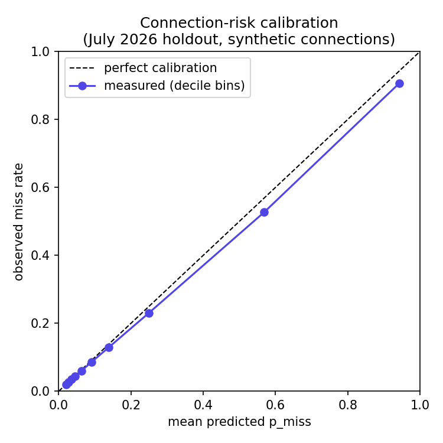

# Model card — Layover delay-propagation models

Covers the LightGBM models that drive every risk shown in the product:
the rotation (pre-departure) model, the schedule-only baseline it's
measured against, and the post-departure model the system switches to
the moment a flight's own departure is known. Trained and evaluated in
Milestone 3; backtested in Milestone 4; connection-level precision,
recall and calibration measured in Milestone 10 (`scripts/
evaluate_connection_risk.py`). Every number below is measured, not
estimated — see `docs/BENCHMARKS.md` for the full methodology behind
each one.

## Intended use

Predicts a flight's arrival delay (minutes) and, from that, the
probability a traveler misses their next connection (`p_miss`), early
enough that a warning has real lead time. Built for US domestic
connections at the 15 hub airports Milestone 5's live ingestion covers,
using real-time aircraft position, weather and FAA status signals
layered on top of the schedule. Not intended for: international routes,
airports outside the demo's monitored set, or as the sole basis for a
rebooking or compensation decision — it's an early-warning signal, not a
guarantee.

## Training data

US BTS On-Time Performance records, July 2026 held out entirely as the
test month; the model trains on data before it. 612,038 non-cancelled,
non-diverted flights in the holdout. Schedule-only features: carrier,
origin, dest, local departure hour/day-of-week/month. Rotation features:
the inbound aircraft's previous-leg outcome, scheduled turnaround time,
a tight-turnaround flag, and the tail's cumulative delay so far that
day — see `src/layover_model/features.py` for the full derivation and
the published reactionary-delay literature it follows (DECISIONS.md).

## Measured performance

**Single-flight delay prediction** (Milestone 3/4, July 2026 holdout,
n=612,038):

| Model | MAE | vs. schedule-only |
| --- | --- | --- |
| Schedule-only baseline | 29.82 min | — |
| Rotation (pre-departure) | 21.41-22.07 min* | ~26-28% better |
| Post-departure | 10.12 min | ~66% better |

\* 21.41 (offline, Milestone 3) vs. 22.07 (event-driven replay,
Milestone 4) — the gap is real and expected: the replay enforces strict
point-in-time correctness (an inbound leg's outcome is only visible once
it has actually landed), which the offline batch table doesn't. See
`docs/BENCHMARKS.md`, Milestone 4.

**15+ minute delay detection** (Milestone 4 backtest, full July 2026
month replayed through the real pipeline):

| Model | Recall | Median lead time (detected) |
| --- | --- | --- |
| Rotation | 64.9% (73.9% on legs with a rotation signal) | 219 min |
| Schedule-only | 11.0% | n/a (flags nearly everything at T-0, not a real warning) |

**Connection-risk (`p_miss`) precision, recall and calibration**
(Milestone 10, same July 2026 holdout, 23,541,240 synthetic connections
at the 15 hub airports — see "Limitations" for what "synthetic" means
here):

| Metric | Value |
| --- | --- |
| Base rate (connection actually missed) | 20.6% |
| Precision at the production alert threshold (`p_miss >= 0.30`) | 67.7% |
| Recall at the production alert threshold | 72.5% |

Calibration (predicted vs. observed miss rate, decile bins):

Calibration is close to the diagonal through the middle deciles and
slightly over-confident at the high end (predicted 94.3% vs. observed
90.7% in the top decile, predicted 56.8% vs. observed 52.7% in the next)
— the model skews a little risk-averse at the extreme, which for a
missed-connection warning is the safer direction to be wrong in, but is
real and worth knowing rather than claiming perfect calibration.

## How `p_miss` is built

Not a second trained model. The rotation/post-departure models are point
predictors (trained to minimize MAE), not distributions. `p_miss` is a
measured empirical-residual lookup: the real (actual minus predicted)
delay distribution on this same July holdout, read off by interpolation
rather than assumed Gaussian (delay is heavily right-skewed — a normal
assumption would badly understate tail risk). See `src/layover_trip/
risk.py` and DECISIONS.md's Milestone 7 research pass for the full
reasoning. One consequence worth naming: because the residual table is
itself measured on this exact holdout, calibration here partly validates
internal consistency, not just generalization — the real test is
whether a *future* month's residuals look like July's, which this
project doesn't have the data to check yet.

## Limitations

- **No real passenger itinerary data exists.** BTS has no booking
  records, so Milestone 10's connection-risk evaluation is built from
  every real flight pair at a hub, same day, 20-180 minutes apart by
  schedule — a plausible connection, not a real one. Real bookings would
  skew toward interline/codeshare pairs scheduled specifically as
  connections, with (probably) different timing patterns than this
  broader synthetic set. Directionally informative, not a substitute for
  real outcome data.
- **First-leg-of-the-day flights have almost no rotation signal**
  (3.9% recall vs. 73.9% on later legs) — there's no inbound aircraft to
  read a delay signal from yet. The schedule-only and weather/FAA-status
  features still apply, but the model's main strength doesn't.
- **Single, fixed minimum-connection-time default (45 min)** for
  evaluation and for any trip that doesn't specify its own — not a real
  per-airport/per-terminal MCT table. Named as a v2 item ("terminal-aware
  connections") in the spec, not solved here.
- **US domestic only**, trained and evaluated on 15 major hubs. Accuracy
  outside that scope is unmeasured, not assumed to transfer.
- **No retraining/drift detection yet.** The spec's own "Model monitoring
  and retraining" is a named v2 extra; this model is a single snapshot
  from Milestone 3's training run, served as-is.
- **Calibration measured on the same holdout the residual table is built
  from** (see above) — a genuinely held-out *future* month would be a
  stronger test than this project currently has the data span to run.

## Versioning

Served models are tracked in MLflow (`mlruns/`), tagged by run name
(`arr_delay_pre_departure_full`, `arr_delay_pre_departure_schedule_only`,
`arr_delay_post_departure_full`); the prediction service and every
evaluation script here load the latest run under that name, so a
retrained model is picked up by re-running `scripts/train_model.py`
without a code change. `RiskAssessment.model_version` records which
specific MLflow run produced each stored prediction, so historical risk
assessments stay attributable to the model that made them even after a
newer one ships.
